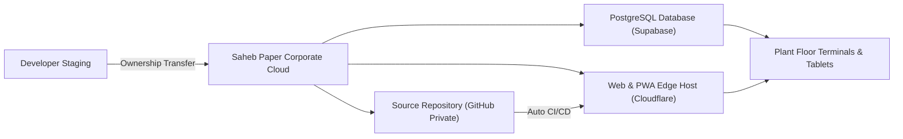
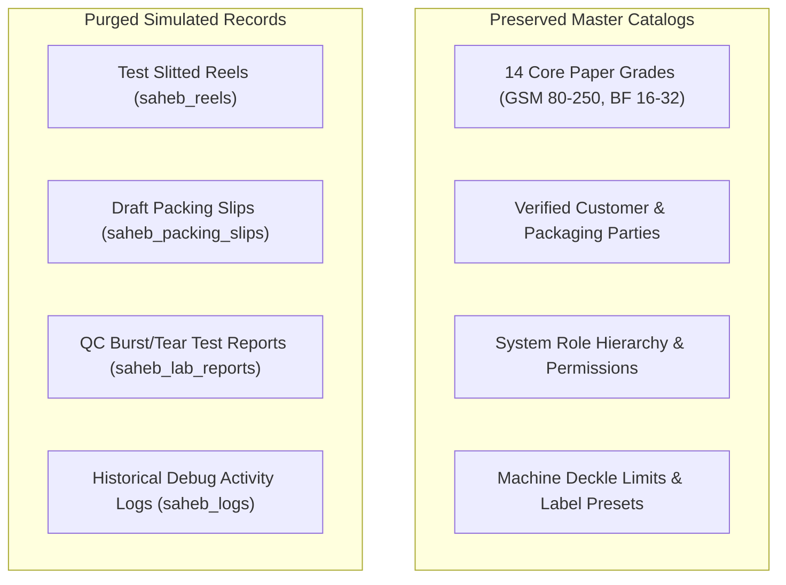
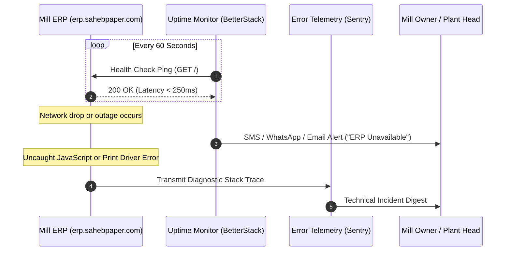
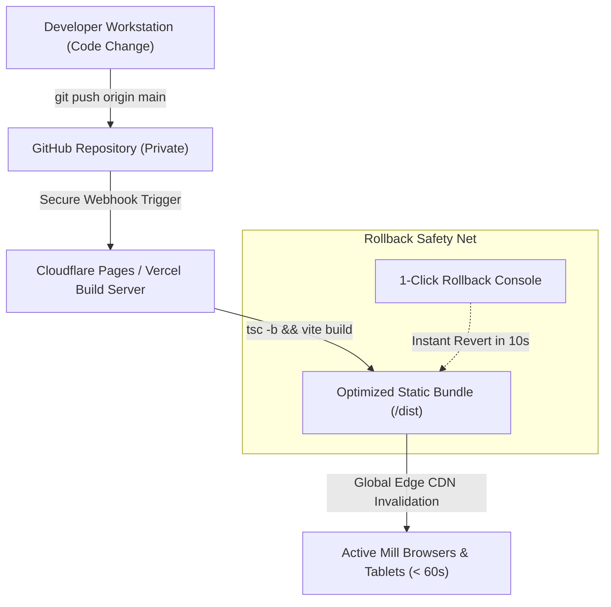

# Saheb Paper ERP - Production Launch & Client Handover Master Dossier

| Document Details | Specifications |
| :--- | :--- |
| **Document Classification** | Proprietary & Confidential - Client Handover Dossier |
| **Target Organization** | Saheb Paper Pvt. Ltd. (Palanpur, Gujarat, India) |
| **System Name** | Saheb Paper Enterprise Manufacturing & Dispatch ERP |
| **Current Application Version** | Release 1.9.0 (Production Candidate) |
| **Architecture Stack** | React 19, TypeScript, Vite, Tailwind CSS, Supabase (PostgreSQL), Cloudflare / Vercel Edge |
| **Target Production Domain** | `erp.sahebpaper.com` |
| **Release Date** | November 2026 |

---

## Executive Summary

This dossier provides the formal engineering, infrastructure, security, and operational handover framework for transitioning the **Saheb Paper Manufacturing & Dispatch ERP** from developer-supervised staging to independent, autonomous ownership by the executive and plant management of **Saheb Paper Pvt. Ltd.**

Following this handbook ensures complete operational autonomy for the paper mill:
1. Complete disassociation of developer personal accounts, email addresses, and temporary staging credentials.
2. Full legal and administrative transfer of cloud database instances, custom domains, and source repositories.
3. Automated uptime monitoring, error telemetry, and disaster recovery requiring zero developer intervention.
4. Continuous deployment pipeline with single-click zero-downtime rollback guarantees.
5. Standard Operating Procedures (SOPs) for floor operators at the Pulper, Rewinder, QC Lab, and Dispatch desk.



---

## 1. Infrastructure Ownership Transfer Protocol

All cloud and compute assets must be systematically reassigned from developer accounts to corporate accounts owned by Saheb Paper Pvt. Ltd.

### 1.1 Cloud Database Instance Transfer (Supabase)

The production database is hosted on a dedicated Supabase PostgreSQL instance.

- **Current Reference Identifier:** `scyiwfqkknuphzhvklok`
- **Dashboard URL:** `https://supabase.com/dashboard/project/scyiwfqkknuphzhvklok`
- **Target Owner Account:** `sahebpaper@gmail.com`

#### Execution Steps:
1. **Account Registration:** The authorized administrator at Saheb Paper registers an account at `supabase.com` using the primary corporate email (`sahebpaper@gmail.com`).
2. **Owner Invitation:** The developer logs into the Supabase management console, navigates to **Project Settings** -> **General** -> **Members**, enters `sahebpaper@gmail.com`, and selects the role **Owner**.
3. **Acceptance:** The administrator accepts the email verification link.
4. **Project Transfer:** The developer accesses **Project Settings** -> **General** -> **Transfer Project**, selects the newly created Saheb Paper Organization, and confirms transfer.
5. **Billing & Disassociation:** The client assigns their corporate payment method for any high-tier scaling needs. Once confirmed, the developer profile is deleted from the members roster.

> [!IMPORTANT]
> Once the Supabase project transfer is confirmed, revoke all developer personal access tokens and change the database master password immediately.

---

### 1.2 Custom Domain & Edge Delivery Network (Cloudflare / Vercel)

- **Staging URL:** `https://saheb-paper-erp.thakordhruv097.workers.dev/`
- **Target Production Host:** `https://erp.sahebpaper.com` (or `https://app.sahebpaper.com`)

#### DNS Records Configuration Table:

| Record Type | Host / Name | Target Value | Proxy Status | TTL |
| :--- | :--- | :--- | :--- | :--- |
| `CNAME` | `erp` | `saheb-paper.pages.dev` (or Vercel target) | Proxied (Orange Cloud) | Auto |
| `TXT` | `_saheb-verification` | Provided by hosting provider | DNS Only | Auto |

#### Security & SSL/TLS Standards:
- **Encryption Mode:** Full (Strict) SSL.
- **Minimum TLS Version:** TLS 1.2.
- **HSTS:** Enabled with 6-month max-age.
- **HTTPS Enforcement:** Automatic 301 redirection from `http://` to `https://`.

#### Production Environment Variables:

```env
# Production Client Environment Configuration
VITE_SUPABASE_URL=https://scyiwfqkknuphzhvklok.supabase.co
VITE_SUPABASE_ANON_KEY=eyJhbGciOiJIUzI1NiIsInR5cCI6IkpXVCJ9...
```

---

### 1.3 Git Repository & Intellectual Property Transfer

- **Current Repository:** `thakordhruv097-spec/saheb-paper`
- **Target Destination:** Client Private GitHub Organization (`github.com/saheb-paper-ltd/saheb-paper-erp`)

#### Transfer Sequence:
1. In GitHub, navigate to **Settings** -> **Danger Zone** -> **Transfer Ownership**.
2. Specify the target user or organization handle.
3. Once accepted by Saheb Paper, verify repository visibility is set to **Private**.
4. Remove all external collaborator seats and enforce branch protection on `main`.

---

## 2. Credentials & Security Rotation Matrix

Every credential, PIN, and cryptographic key must be replaced with private values known only to authorized plant personnel.

### 2.1 Master Credentials Handover Table

| Role / Surface | Default Staging Value | Production Assignment Procedure | Managed In |
| :--- | :--- | :--- | :--- |
| **Admin Master Console** | `admin` / `1234` | Replace with confidential 4-6 digit numeric master PIN | App UI: **Admin Masters -> User Management** |
| **Master Security Question** | `What is your favorite color?` / `blue` | Configure unique private question and confidential passphrase | App UI: **Profile -> Security Questions** |
| **Plant Manager** | `plant_manager` / `1234` | Assign to Operations Head; provides shift & QC oversight | App UI: **User Management** |
| **Pulper Operator** | `pulper` / `1122` | Assign to Raw Material & Chemical Dosing Lead | App UI: **User Management** |
| **Rewinder Operator** | `rewinder` / `1234` | Assign to Slitter/Cutter machine crew | App UI: **User Management** |
| **Dispatcher Desk** | `dispatcher` / `1234` | Assign to weighbridge & packing slip desk | App UI: **User Management** |
| **Store & Procurement** | `shop` / `1234` | Assign to spare parts, wire, felt, and bearings store | App UI: **User Management** |
| **Auditor / Bank Viewer** | `viewer` / `1234` | Read-only mode; locked from modifying stock or challans | App UI: **User Management** |
| **Database Master Key** | Initial build string | Reset via Supabase Dashboard to high-entropy 32-character string | Cloud: **Database -> Settings** |

> [!WARNING]
> Do not permit floor operators to share PINs. Each shift supervisor must retain a discrete login to ensure exact traceability in the immutable audit log (`saheb_logs`).

### 2.2 Security Policies Implemented in Core Engine
- **Brute-Force Guard:** 5 consecutive failed PIN attempts trigger automatic 30-minute lockout. Unlocking requires Admin Master intervention or matching the security challenge question.
- **Session Duration:** Active sessions terminate after 8 hours of continuous operation to match factory shift boundaries.
- **Role Isolation:** Operators are strictly routed to their operational modules (e.g., Rewinder operators cannot edit financial masters or delete party records).

---

## 3. Pre-Launch Database Scrubbing (Clean Slate Execution)

Before live commercial slitting and customer dispatch commence, simulated dummy records must be cleared while safeguarding foundational master setups.



### 3.1 SQL Sanitization Script
Execute the following commands inside the **Supabase SQL Editor** to establish day-zero production counters:

```sql
-- ====================================================================
-- SAHEB PAPER ERP - PRODUCTION CLEAN SLATE SANITIZATION
-- ====================================================================

BEGIN;

-- 1. Wipe all operational transactions
TRUNCATE TABLE saheb_reels CASCADE;
TRUNCATE TABLE saheb_packing_slips CASCADE;
TRUNCATE TABLE saheb_lab_reports CASCADE;
TRUNCATE TABLE saheb_logs CASCADE;

-- 2. Audit confirmation of retained master catalogs
DO $$
DECLARE
    v_products integer;
    v_parties integer;
    v_users integer;
BEGIN
    SELECT COUNT(*) INTO v_products FROM saheb_products;
    SELECT COUNT(*) INTO v_parties FROM saheb_parties;
    SELECT COUNT(*) INTO v_users FROM saheb_users;

    RAISE NOTICE 'Sanitization Complete. Master Catalog Counts -> Products: %, Parties: %, Users: %',
        v_products, v_parties, v_users;
END $$;

-- 3. Seed authoritative production initialization marker
INSERT INTO saheb_logs (id, timestamp, action, details, "user", role)
VALUES (
    gen_random_uuid(),
    NOW(),
    'PRODUCTION_CLEAN_SLATE',
    'System sanitized for live mill commercial operations. Delivery Challan counter reset to #PS-1.',
    'admin',
    'Admin'
);

COMMIT;
```

> [!NOTE]
> Following script execution, the very next delivery slip generated by the dispatch console will automatically register as **Challan #PS-1**.

---

## 4. Autonomous Monitoring & Mill Health Telemetry

Zero ongoing developer maintenance is achieved through automated telemetry platforms.



### 4.1 Uptime Monitoring Specification
- **Recommended Platform:** BetterStack Telemetry or UptimeRobot (Free Enterprise Tier).
- **Endpoint Monitored:** `https://erp.sahebpaper.com`
- **Cadence:** Probe executed every 60 seconds from 5 global nodes.
- **Incident Escalation:** If 2 consecutive probes fail (> 120 seconds), automated alerts trigger via SMS, WhatsApp, and email to mill management.

### 4.2 Application Error Tracking (Sentry)
- **Engine:** Sentry Browser Telemetry for React 19.
- **Functionality:** Silently intercepts client-side rendering crashes, network disconnects during slip creation, or printer communication timeouts, cataloging device type, operating system, and stack trace without halting operator UI.

### 4.3 Disaster Recovery & Data Backup Strategy
- **Cloud Automated Snapshots:** Supabase executes daily automated database snapshots with Point-in-Time Recovery (PITR) retained for 7 rolling days.
- **Weekly Local Air-Gapped Backup:**
  1. The Plant IT Incharge logs into the **Admin Masters** module.
  2. Selects **System Audit & Backups** -> **Download Complete Database Snapshot**.
  3. Saves the timestamped JSON and encrypted Excel archive to an external office storage drive.

---

## 5. Continuous Deployment & Software Update Pipeline

Future software enhancements, regulatory tax adjustments, or new label layouts are deployed through an automated continuous integration pipeline.



### 5.1 Web App / Progressive Web App (PWA) Delivery
- **Mechanism:** Git-triggered automated continuous deployment.
- **Operator Impact:** Zero installation footprint. Operators receive updates immediately upon browser refresh without downloading installation packages.
- **Zero-Downtime Guarantee:** The edge delivery network serves the existing version until the new build compiles cleanly, eliminating plant downtime.

### 5.2 Single-Click Emergency Rollback
If an update introduces unexpected behavior:
1. Open the hosting management console (Cloudflare Pages or Vercel).
2. Navigate to **Deployments** history.
3. Select the prior stable release and click **Rollback to this deployment**.
4. The production environment reverts worldwide within 10 seconds.

### 5.3 Native Android APK Compilation (Capacitor)
If ruggedized Android barcode handhelds require updated native APK containers:
```powershell
# 1. Update application release version in package.json
npm version minor

# 2. Compile optimized production assets
npm run build

# 3. Synchronize native Android platform assets
npx cap sync android

# 4. Generate signed release APK
cd android
./gradlew.bat assembleRelease
cd ..
```
The resulting binary (`android/app/build/outputs/apk/release/app-release.apk`) is loaded directly onto handheld terminals via USB or plant Wi-Fi.

---

## 6. Shop-Floor Standard Operating Procedures (SOPs)

Laminate and mount these concise procedural guides at respective plant workstations.

### 6.1 Station 1: Rewinder Roll-to-Reel Operator
1. **Authentication:** Enter assigned 4-digit operator PIN on the terminal touchscreen.
2. **Mother Roll Registration:** Select Paper Machine Jumbo Roll ID; confirm deckle width, target GSM, and target BF grade.
3. **Slitting Formulation:** Specify output child reel widths (e.g. 3 × 40" or custom slit program).
4. **Execution:** Click **Process Slitting & Generate Reels**. The engine assigns sequential, globally unique traceability IDs (e.g., `R-261103-01`).
5. **Thermal Tag Printing:** Click **Print Label**. The thermal printer produces the 100×150 mm adhesive tag with high-contrast QR code, gross weight, net weight, joint count, and operator signature badge.
6. **Application:** Affix label to reel core and outer wrap prior to warehouse transfer.

### 6.2 Station 2: Dispatch & Weighbridge Desk
1. **Authentication:** Log in via Dispatcher credentials on the desktop PC.
2. **Draft Challan Creation:** Navigate to **Dispatch Receipt** -> **+ Draft Packing Slip**.
3. **Vehicle & Consignee Entry:** Select buyer from the registered customer directory. Input Order No, Truck Registration No (e.g., `GJ-05-BX-4921`), and driver name.
4. **Reel Manifest Allocation:** Pick ready warehouse stock reels matching order specifications. Loaded reel count and net metric tonnage tally dynamically in real time.
5. **Gate Pass Execution:** Click **Print Gate Pass & Dispatch**.
   - Outputs official multi-page A4 Delivery Challan documentation.
   - Transitions selected reel statuses from `IN_STOCK` to `DISPATCHED`.
   - Security gate staff verifies physical reels against the digital manifest via mobile scanner.

### 6.3 Station 3: Plant Operations & Executive Audit
1. **Executive Oversight:** Open **Dashboard** to monitor real-time mill metrics: Total Inventory MT, Loaded MT, Daily Production Yield, and QC Clearance status.
2. **Staff Administration:** Grant, reassign, or revoke credentials via **Admin Masters -> User Management**.
3. **Audit Verification:** Inspect the immutable **Activity Logs** to review reel creation timestamps, re-weigh adjustments, and gate pass clearances.

---

## 7. Pre-Flight Verification & Acceptance Sign-Off

All items must be verified and signed off before concluding technical handover.

| # | Verification Gate | Target Criterion | Verified By | Date | Status |
| :-: | :--- | :--- | :--- | :-: | :-: |
| **1** | Database Cloud Transfer | Supabase project ownership transferred to `sahebpaper@gmail.com` | Client / IT | ____/____ | [ ] Pass |
| **2** | Custom Domain Resolution | `erp.sahebpaper.com` live with valid Full (Strict) SSL certificate | Developer | ____/____ | [ ] Pass |
| **3** | Master Admin PIN Rotation | Default `1234` changed to confidential client master PIN | Client Executive | ____/____ | [ ] Pass |
| **4** | Security Questions Setup | Secret challenge question and answer configured in Admin profile | Client Executive | ____/____ | [ ] Pass |
| **5** | Staff Role Distribution | Discrete PINs assigned to Pulper, Rewinder, Dispatch, and Store staff | Plant Manager | ____/____ | [ ] Pass |
| **6** | Transaction Sanitization | Test reels, challans, and logs wiped; clean slate confirmed at `#PS-1` | Technical Lead | ____/____ | [ ] Pass |
| **7** | Master Catalog Integrity | 14 Products, Customer Parties, and GSM/BF specs validated | Plant Head | ____/____ | [ ] Pass |
| **8** | Thermal Printing Accuracy | TSC/Zebra 100×150 mm reel sticker prints legible barcodes & QR | Rewinder Lead | ____/____ | [ ] Pass |
| **9** | Challan Printing Accuracy | A4 Delivery Challan & Gate Pass format tested and approved | Dispatch Head | ____/____ | [ ] Pass |
| **10** | Autonomous Telemetry | 60-second BetterStack/UptimeRobot ping configured with SMS alerts | Technical Lead | ____/____ | [ ] Pass |
| **11** | Cloud Snapshot Recovery | Supabase automated daily backups verified active in dashboard | Technical Lead | ____/____ | [ ] Pass |
| **12** | Git Repository Handover | GitHub repository transferred to private company ownership | Developer | ____/____ | [ ] Pass |
| **13** | Credentials Vault Delivery | Confidential physical/digital credentials envelope handed to board | Client Executive | ____/____ | [ ] Pass |

---

### Formal Handover Execution

**Delivered By Technical Architecture Lead:**  
Name: _____________________________________________  
Signature: __________________________________________  
Date: ______________________________________________  

**Accepted on behalf of Saheb Paper Pvt. Ltd. Management Board:**  
Name: _____________________________________________  
Title: Managing Director / Plant Head  
Signature: __________________________________________  
Date: ______________________________________________  
Corporate Seal:
